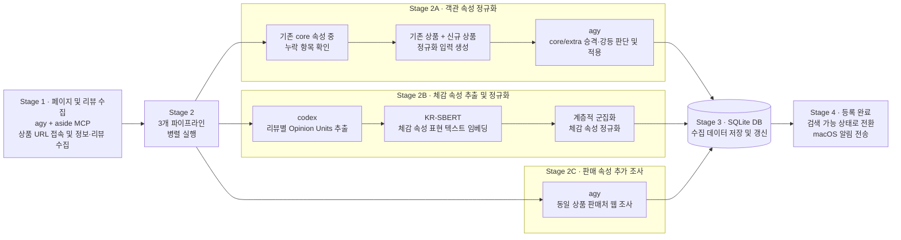

# Meta-search MCP

[](https://modelcontextprotocol.io) [](https://www.python.org/) [](https://github.com/modelcontextprotocol/python-sdk)

**상품의 객관적 사양, 사용자 리뷰, 판매 정보를 통합하여 검색하고 비교하는 Model Context Protocol(MCP) 서버입니다.**

- meta-search는 상품의 사양뿐 아니라 실제 사용자가 느낀 특징과 판매 조건까지 함께 고려하여 AI 에이전트가 상품을 탐색하고 비교할 수 있도록 지원합니다.
- 수집된 상품 데이터는 로컬 SQLite 카탈로그에 저장되며, MCP를 지원하는 AI 클라이언트에서 자연어로 검색할 수 있습니다.
- [semantic-review-extraction](https://github.com/subjective-experience-shopping-platform/semantic-review-extraction-experiment) 실험을 통해 유효성을 확인한 속성 추출 구조와 속성 표현 정규화 방법을 적용하여 체감 속성을 수집합니다.

## 주요 기능

- **통합 상품 검색:** 객관적 사양, 체감 속성, 가격·배송·재고 조건을 결합해 상품을 검색하고 정렬합니다.
- **리뷰 기반 분석:** 사용자 리뷰에서 추출한 Opinion Unit을 활용하여 타건감, 소음 등 실제 사용 경험을 비교합니다.
- **상품 비교:** 여러 상품의 사양, 판매 정보, 리뷰 통계를 비교하고 주요 차이점을 요약합니다.
- **근거 기반 검색:** 실제 리뷰 발췌문과 통계 정보를 제공하며 조건에 부합하는 상품과 정보가 부족한 상품을 구분합니다.
- **상품 자동 등록:** URL을 입력하면 상품 정보와 리뷰, 판매 정보를 비동기로 수집하고 카탈로그에 등록합니다.
- **로컬 데이터 검색:** SQLite 기반으로 동작하며 데이터 정규화에 필요한 경우 외부 백엔드를 활용합니다.

## 시작하기

### 요구 사항

- `Antigravty2`, `ChatGPT(codex)`, `aside browser`가 설치 및 인증되어 있어야 하며 각각 `agy`, `codex`, `aside`를 통해 호출할 수 있어야 합니다. 3가지 모두 반드시 유료 플랜을 구독하지 않아도 됩니다.
- `Python >= 3.11`, `SQLite >= 3.45`를 요구합니다.

### 설치

프로젝트 루트에서 다음 명령어로 의존성을 설치합니다.

```bash
uv sync --python 3.11
```

별도 배포본(`release/meta-search`)을 사용하는 경우 설치 스크립트를 이용할 수 있습니다.

```bash
python3 install.py
```

설치 스크립트는 실행 환경과 의존성을 구성하며 기본적으로 Codex MCP 등록도 지원합니다.

### MCP 클라이언트 설정

Claude Desktop 또는 Cursor 등에서 사용할 수 있는 `stdio` 설정 예시입니다.

```json
{
  "mcpServers": {
    "meta-search": {
      "command": "/absolute/path/to/meta-search/.venv/bin/python",
      "args": ["-m", "meta_search.server"],
      "env": {
        "META_SEARCH_CONFIG": "/absolute/path/to/meta-search/config.toml"
      }
    }
  }
}
```

`/absolute/path/to/meta-search`를 실제 프로젝트 경로로 변경합니다.

클라이언트마다 설정 파일 위치와 구성 형식이 다를 수 있으며 VS Code 등 일부 클라이언트는 별도의 설정 형식을 사용합니다.

## 사용 예시

MCP 서버 연결 후 AI 에이전트에 자연어로 요청할 수 있습니다.

**조건에 맞는 상품 검색**

> 20만 원 이하이면서 무게가 900g 이하인 키보드를 찾아줘.

**사용 경험 기반 추천**

> 사용자 리뷰를 바탕으로 타건감이 좋고 소음이 적은 키보드를 추천해줘.

**상품 비교**

> 선택한 두 키보드의 주요 사양과 가격, 실제 사용자들의 타건감 평가를 비교해줘.

**신규 상품 등록**

> 이 상품을 카탈로그에 등록해줘: https://example.com/product

상품 등록은 명시적인 요청이 있을 때 수행하며, 등록 요청 후 반환되는 작업 ID로 진행 상태를 확인할 수 있습니다.

## 제공 도구

meta-search는 총 11개의 MCP 도구를 제공합니다.

| 도구 | 설명 |
|---|---|
| `get_search_guide` | 검색 가능한 카테고리와 속성, 필터 확인 |
| `search_products` | 사양·체감·판매 조건을 결합한 상품 검색 |
| `compare_products` | 여러 상품의 주요 차이점 비교 |
| `get_product_details` | 상품의 상세 사양 및 정보 조회 |
| `search_product_docs` | 상품 상세 설명 내 키워드 검색 |
| `find_review_attributes` | 리뷰에서 추출한 체감 속성 탐색 |
| `list_review_states` | 체감 속성별 상태 및 표현 조회 |
| `get_review_evidence` | 실제 사용자 리뷰 근거 조회 |
| `get_offers` | 판매처별 가격·배송·재고 정보 조회 |
| `register_product` | 신규 상품 URL 등록 및 수집 요청 |
| `get_registration_status` | 상품 등록 작업의 진행 상태 확인 |

11개 도구 중 `register_product`를 제외한 10개는 조회 전용입니다.

체감 속성 검색은 `find_review_attributes`와 `list_review_states`에서 유효한 속성과 상태를 확인한 뒤 `search_products`에 검색 조건을 전달하는 방식으로 동작합니다.

## 데이터 처리 구조

meta-search는 다음 세 종류의 데이터를 통합합니다.

| 데이터 | 주요 내용 |
|---|---|
| **Objective** | 제품 사양 및 카테고리별 핵심 속성 |
| **Experience** | 사용자 리뷰에서 추출한 체감 속성과 평가 |
| **Sales** | 판매처별 가격, 배송 및 재고 정보 |

신규 상품 등록 과정에서는 `agy`와 `aside`를 활용하여 웹 페이지와 리뷰를 수집하고 Codex로 객관 속성과 Opinion Unit을 추출합니다.

체감 속성의 정규화는 로컬 Exact-Match를 기본으로 사용하며 필요시 AWS Lambda 기반 KR-SBERT 군집화를 통해 유사한 표현을 통합합니다.

검색 단계에서는 확인되지 않은 정보를 임의로 충족 또는 불충족으로 판단하지 않고 별도의 판정 불가 결과로 구분합니다.

### 신규 상품 등록 및 수집 로직

register_product tool을 통해 신규 상품을 등록하거나 수집할 때 수행되는 핵심 로직입니다. 전체 로직은 [register_product_flow.mmd](register_product_flow.mmd)에서 확인하실 수 있습니다.



## 설정

주요 실행 설정은 `config.toml`에서 관리합니다.

| 설정 | 용도 |
|---|---|
| `META_SEARCH_CONFIG` | 설정 파일 경로 지정 |
| `META_SEARCH_CLUSTER_TOKEN` | AWS Lambda 원격 정규화 인증 |
| `config.toml` | 데이터 경로, 수집 한도, CLI 및 정규화 설정 |

원격 정규화 토큰은 필요한 경우에만 사용되며 환경 변수 또는 별도 토큰 파일로 관리할 수 있습니다. 원격 정규화 토큰은 AWS 관리자가 명시적으로 부여하며 자동으로 발급되지 않습니다.

> [!WARNING]
> **본 MCP는 정식 배포 용도가 아닙니다.**
>
> 본 MCP는 가까운 지인들과 함께 사용할 목적으로 만들어진 MCP입니다. 이에 따라 원격 정규화 토큰은 허용된 인원만 제한적으로 사용할 수 있습니다. 다만 원격 정규화는 속성 갱신에만 사용되므로 상품 검색 기능을 사용하는 데는 문제가 없으며 서버를 비롯한 모든 코드가 공개되어 있어 `git clone`을 통해 직접 사용할 수 있습니다.


## 라이선스

프로젝트 코드는 [GNU GPL 3.0](LICENSE)을 따릅니다. 외부 데이터셋과 모델의 이용 조건은 각 원본 제공처의 조건을 따릅니다.
